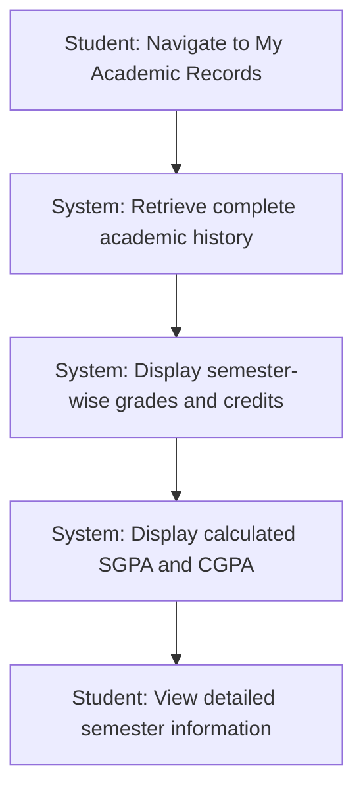
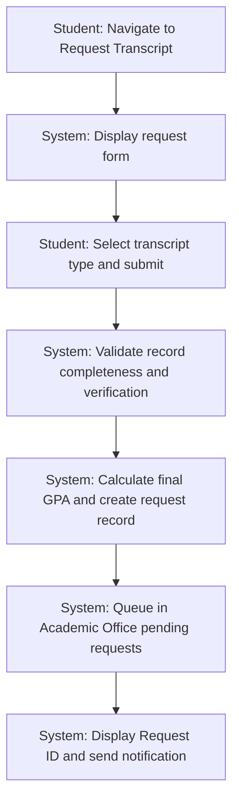
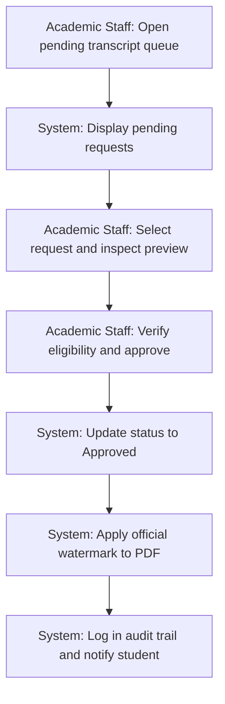
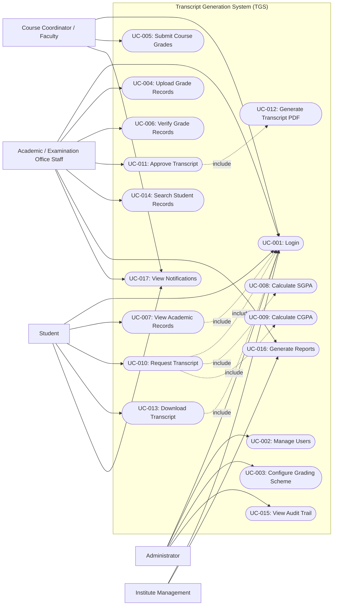
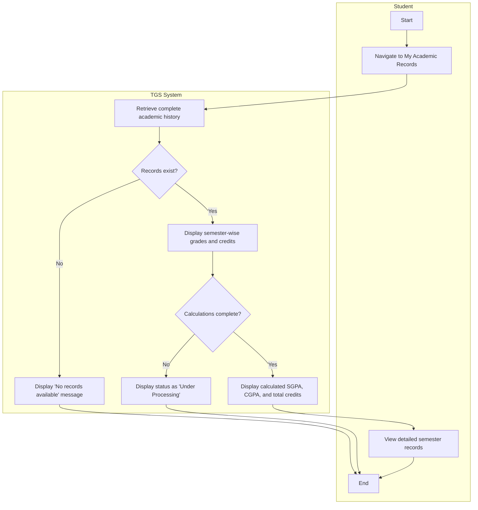
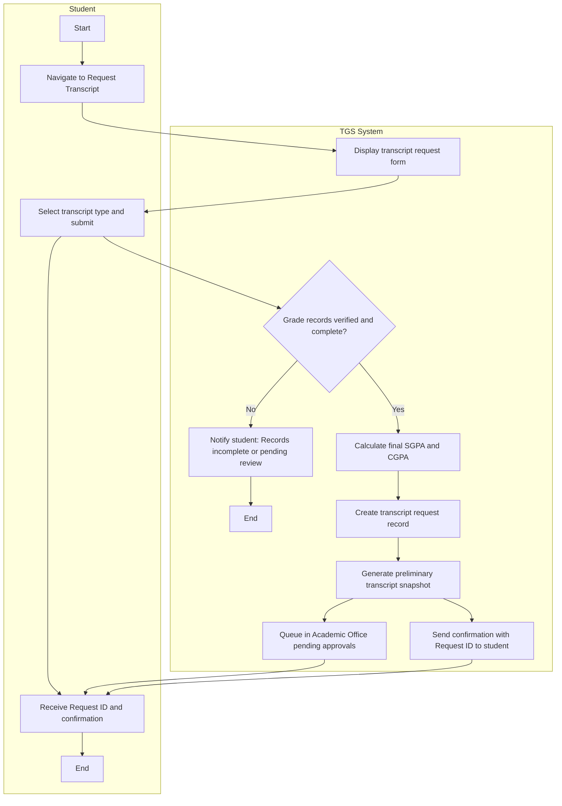
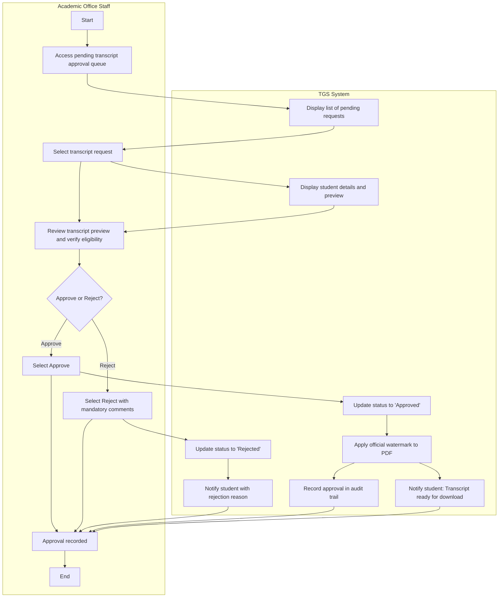

# The LNM Institute of Information Technology, Jaipur
## Software Development Laboratory
**Course Code:** CS314  
**Lab Assignment 3:** Scenario, Use Case and Activity Modelling  
**Project:** Transcript Generation System (TGS)  
**Team ID:** T029  
**Team Members:** Ayush Agarwal, Yash Sharma, Jatin Dangi, Daksh Kedia  
**Roll Numbers:** 24UCC171, 24UCC172, 24UCC173, 24UCC174  
**Development Model:** Agile - Iterative and Incremental Development  

---

## 30. Scenarios

The three detailed use cases defined in Assignment 2 are carried forward without introducing new functionality:
- **UC-007:** View Academic Records
- **UC-010:** Request Transcript
- **UC-011:** Approve Transcript

---

### Scenario: UC-007 — View Academic Records

| Field | Description |
|---|---|
| **Actor(s) involved** | **Primary:** Student. **Supporting:** Transcript Generation System. |
| **Starting condition** | The Student is authenticated and has at least one completed semester with verified grade records in the institutional database. |
| **Main sequence of activities** | 1. The student navigates to the "My Academic Records" section. 2. The system retrieves the student's complete academic history from the centralized database. 3. The system displays semester-wise grade records (course code, name, credits, and grade obtained). 4. The system calculates and displays the Semester Grade Point Average (SGPA) for each semester. 5. The system displays the Cumulative Grade Point Average (CGPA) across all completed semesters. 6. The system displays total credits earned to date. 7. The student selects and views detailed records for any specific semester. |
| **Important alternative / exception flows** | • **No Records Available:** If no grade records exist for the student, the system displays a "No records available" message. • **Pending Calculations:** If grade verification or SGPA/CGPA calculation is pending, the system displays the status as "Under Processing". • **Unauthorized Access:** If a user attempts to access another student's academic history, access is blocked and an unauthorized access attempt is logged. |
| **Expected outcome** | The student successfully views their complete academic history, including verified grades, earned credits, semester SGPAs, and cumulative CGPA without unauthorized modifications. |

#### Compact Representation: UC-007

---

### Scenario: UC-010 — Request Transcript

| Field | Description |
|---|---|
| **Actor(s) involved** | **Primary:** Student. **Supporting:** Transcript Generation System; Academic Office Staff receives the pending request. |
| **Starting condition** | The Student is authenticated and has at least one completed semester with fully verified and approved academic grade records. |
| **Main sequence of activities** | 1. The student navigates to the "Request Transcript" section. 2. The system displays the transcript request form. 3. The student selects the transcript type (`Official` or `Unofficial`) and optionally provides a purpose or remarks. 4. The student submits the transcript request. 5. The system validates that all semester grade records are complete, verified, and free of discrepancies. 6. The system creates a transcript request record and calculates the final SGPA and CGPA. 7. The system generates a preliminary transcript snapshot. 8. The system routes the request to the Academic Office pending approval queue. 9. The system displays an on-screen confirmation with a unique Request ID to the student. 10. The system dispatches an automated notification to Academic Office staff. |
| **Important alternative / exception flows** | • **Incomplete Records:** If grade records are missing, incomplete, or unverified, the system blocks submission and notifies the student. • **Pending Corrections:** If a semester record has pending grade corrections, the request is paused until resolution. • **Generation Failure:** If an error occurs during PDF preliminary generation, the transaction rolls back and an error is logged. |
| **Expected outcome** | A formal transcript request record is created in `Pending` status; preliminary calculations are verified; the request is queued for Academic Office review; and an acknowledgement is issued to the student. |

#### Compact Representation: UC-010

---

### Scenario: UC-011 — Approve Transcript

| Field | Description |
|---|---|
| **Actor(s) involved** | **Primary:** Academic Office Staff. **Supporting:** Transcript Generation System; Student receives the approval notification. |
| **Starting condition** | The staff member is authenticated with Academic Office credentials; a transcript request exists in `Pending` status; and all associated semester grade records are verified. |
| **Main sequence of activities** | 1. The staff member accesses the pending transcript approval queue. 2. The system displays the list of pending transcript requests. 3. The staff member selects a request to inspect. 4. The system presents student details along with an interactive preliminary transcript preview. 5. The staff member reviews the transcript for accuracy and verifies student institutional eligibility. 6. The staff member selects **Approve**. 7. The system updates the transcript status to `Approved`. 8. The system applies the official institutional watermark to the final PDF. 9. The system logs the approval event, approver ID, and timestamp in the audit trail. 10. The system generates and sends a notification alerting the student that their official transcript is ready for download. |
| **Important alternative / exception flows** | • **Discrepancies Found:** The staff member selects `Reject` and enters mandatory rejection comments; the system marks the request `Rejected` and notifies the student. • **Manual Scrutiny Required:** The staff member marks the request for additional departmental review. • **Eligibility Revoked:** If student clearance is withheld, the request is rejected with reason. |
| **Expected outcome** | The transcript request is marked `Approved`; an official watermarked PDF is compiled and stored; the audit trail is updated; and the student is notified that the document is ready for download. |

#### Compact Representation: UC-011

---

## 31. UML Use Case Diagram — Complete System

**Relationship Notes:**
- `UC-001 Login` is included (`include`) in all primary operations requiring secure role authentication (`UC-007`, `UC-010`, and `UC-013`).
- `UC-008 Calculate SGPA` and `UC-009 Calculate CGPA` are included (`include`) in `UC-010 Request Transcript` to validate credit totals and grade summaries.
- `UC-012 Generate Transcript PDF` is included (`include`) in `UC-011 Approve Transcript` upon applying the official watermark.

---

## 32. Activity Diagrams

### 32.1 UC-007 — View Academic Records

---

### 32.2 UC-010 — Request Transcript

---

### 32.3 UC-011 — Approve Transcript

---

## 33. Consistency and Traceability Check

The models preserve the required chain:  
**Assignment 2 requirements -> the same 3 detailed use cases -> scenarios -> complete-system use case diagram -> activity diagrams.**  
No new system functionality has been introduced.

| Detailed Use Case | Assignment 2 Source | Requirement Basis | Scenario | Activity Diagram |
|---|---|---|---|---|
| **UC-007 View Academic Records** | Section 19.1 | FR-028, FR-015, FR-017, FR-020; record viewing and GPA display rules | Scenario 1 | 32.1 |
| **UC-010 Request Transcript** | Section 19.2 | FR-022, FR-023, BR-004, BR-005, BR-010; eligibility checks and request queuing | Scenario 2 | 32.2 |
| **UC-011 Approve Transcript** | Section 19.3 | FR-025, FR-027, FR-041, BR-006, BR-012; verification, watermark, and audit logging | Scenario 3 | 32.3 |

---

## 35. Individual Contribution

- **Daksh Kedia (24UCC174):** Traced scenarios and activity workflows directly back to functional requirements and business rules, ensuring end-to-end traceability for UC-007, UC-010, and UC-011.
- **Yash Sharma (24UCC172):** Designed the complete-system UML use case diagram, structured actor associations, and verified swimlane interactions across the system boundary.
- **Ayush Agarwal (24UCC171):** Prepared the detailed scenario specifications and activity diagrams for UC-010 (Request Transcript) and UC-011 (Approve Transcript).
- **Jatin Dangi (24UCC173):** Prepared the activity model for UC-007 (View Academic Records), verified diagram consistency with Assignment 2 specifications, and compiled GitHub documentation.

---

## AI Usage Policy — Student Declaration

AI tools may be used as supporting tools for this assignment. The team is responsible for the correctness, consistency, and understanding of all submitted scenarios and UML models.
- We have disclosed the use of AI tools, if any.
- AI-generated suggestions have been reviewed, verified, and adapted by the team.
- We understand and can explain the submitted scenarios, use case diagram, and activity diagrams.
- We have verified that the UML models are consistent
