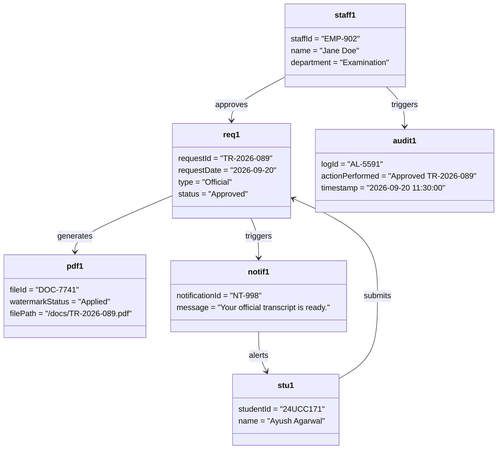
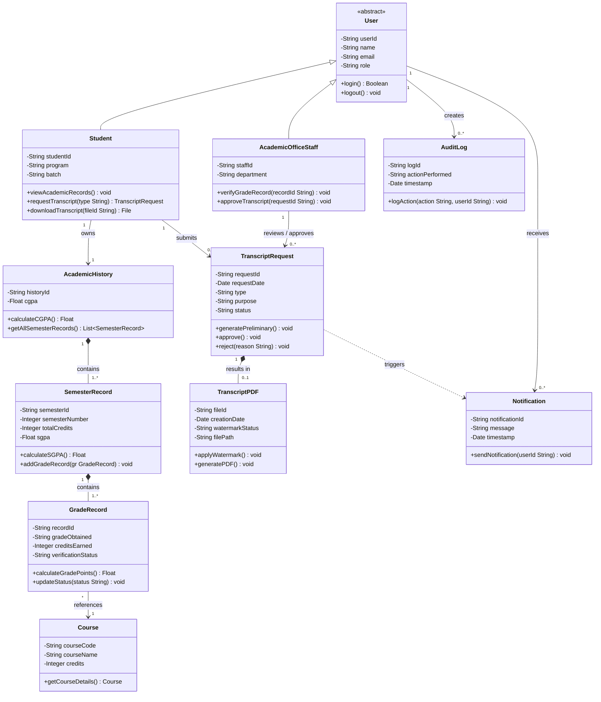

# The LNM Institute of Information Technology, Jaipur
## Software Development Laboratory
**Course Code:** CS314  
**Lab Assignment 4:** Classes, Object Diagram and Relationships  
**Project:** Transcript Generation System (TGS)  
**Team ID:** T029  
**Team Members:** Ayush Agarwal, Yash Sharma, Jatin Dangi, Daksh Kedia  
**Roll Numbers:** 24UCC171, 24UCC172, 24UCC173, 24UCC174  
**Development Model:** Agile - Iterative and Incremental Development  

---

## 36. Classes

The system domain model comprises 11 primary classes mapped directly to the requirements baseline established in SRS v1.0. Note that the Notification system and Audit Log act as system components and are represented as classes rather than external actors.

| Class | Key Attributes | Key Operations | Traces to |
|---|---|---|---|
| **User** *(abstract)* | `userId`, `name`, `email`, `role`, `accountStatus`, `lastLogin` | `authenticate()`, `logout()` | FR-001–005 |
| **Student** | `studentId`, `program`, `batch`, `currentSemester` | `viewAcademicRecords()`, `requestTranscript()`, `downloadTranscript()` | FR-022, FR-026, FR-028, UC-007, UC-010 |
| **AcademicOfficeStaff** | `staffId`, `department` | `verifyGradeRecord()`, `approveTranscript()`, `searchStudentRecords()` | FR-010, FR-025, FR-030, UC-011 |
| **Course** | `courseCode`, `courseName`, `credits`, `department`, `courseType` | `getCourseDetails()` | FR-008, FR-012 |
| **GradeRecord** | `recordId`, `studentId`, `courseCode`, `semester`, `gradeObtained`, `creditsEarned`, `verificationStatus` | `calculateGradePoints()`, `updateStatus()` | FR-008, FR-012, BR-002, BR-003 |
| **SemesterRecord** | `semesterId`, `studentId`, `semesterNumber`, `academicYear`, `totalCredits`, `sgpa`, `status` | `calculateSGPA()`, `addGradeRecord()` | FR-016, FR-017, BR-004 |
| **AcademicHistory** | `historyId`, `studentId`, `cgpa`, `calculationDate` | `calculateCGPA()`, `getAllSemesterRecords()` | FR-019, FR-020, BR-005 |
| **TranscriptRequest** | `requestId`, `studentId`, `requestDate`, `type`, `purpose`, `status`, `approvedBy` | `generatePreliminary()`, `approve()`, `reject()` | FR-022, FR-025, BR-006, BR-012 |
| **TranscriptPDF** | `fileId`, `transcriptId`, `creationDate`, `watermarkStatus`, `filePath` | `applyWatermark()`, `generatePDF()` | FR-024, FR-027 |
| **AuditLog** | `logId`, `userId`, `actionPerformed`, `entityAffected`, `changesMade`, `timestamp` | `logAction()` | FR-041, FR-042 |
| **Notification** | `notificationId`, `recipientId`, `notificationType`, `message`, `timestamp`, `readStatus` | `sendNotification()` | FR-032–035 |

---

## 37. Object Diagram

### UC-011 (Approve Transcript) — Instance Snapshot
The object diagram below captures the exact system runtime state immediately following the execution of **UC-011 (Approve Transcript)** by academic office staff member Jane Doe:

**Snapshot Description:**  
This object diagram represents a runtime snapshot of the system during the **UC-011: Approve Transcript** scenario. An instance of `AcademicOfficeStaff` (`staff1`: Jane Doe) actively reviews and approves a pending `TranscriptRequest` (`req1`) submitted by `Student` (`stu1`: Ayush Agarwal). Upon successful approval, the system links the request to the finalized `TranscriptPDF` (`pdf1`) with an official watermark applied. Simultaneously, the system triggers the creation of an `AuditLog` entry (`audit1`) for administrative accountability and dispatches a `Notification` (`notif1`) alerting the student that their document is ready for download.

---

## 38. Relationships

### Generalization / Inheritance
- **`Student` and `AcademicOfficeStaff` specialize `User`** (inherit from abstract parent class `User`) because all roles authenticate identically (`FR-001`), while their permitted operations differ based on role assignments (`FR-005`).

### Composition
- **`AcademicHistory` "1" *-- "1..*" `SemesterRecord`:** CGPA calculation includes all completed semesters (`BR-005`); a semester record does not exist independently of a student's complete academic history.
- **`SemesterRecord` "1" *-- "1..*" `GradeRecord`:** SGPA is calculated from specific grade records (`FR-016`, `BR-004`); a grade record has no independent lifecycle outside its semester.
- **`TranscriptRequest` "1" *-- "0..1" `TranscriptPDF`:** The system generates a standardized PDF for each official request (`FR-024`); the generated document is meaningless if the transcript request is deleted.

### Association
- **`Student` "1" -- "1" `AcademicHistory`:** A student is authorized to view their complete academic history across all semesters (`FR-028`).
- **`GradeRecord` "*" -- "1" `Course`:** Grade records are tied to specific courses to determine course credit weight for GPA calculations (`FR-012`).
- **`Student` "1" -- "0..*" `TranscriptRequest`:** Authenticated students can request the generation of their academic transcripts (`FR-022`, `UC-010`).
- **`AcademicOfficeStaff` "1" -- "0..*" `TranscriptRequest`:** Academic office staff review and approve pending transcript generation requests (`FR-025`, `UC-011`).
- **`User` "1" -- "0..*" `AuditLog`:** Significant user actions, such as approvals and modifications, are logged against the acting user's identity (`FR-041`, `FR-042`).
- **`User` "1" -- "0..*" `Notification`:** The system sends status and approval notifications to specific users (`FR-033`, `FR-034`).

### Dependency
- **`TranscriptRequest` ..> `Notification` \<\<triggers\>\>:** Approving a transcript request directly triggers the creation of a notification dispatched to the student (`UC-011`).

---

### Complete UML Class Diagram

---

## 39. Individual Contribution

- **Daksh Kedia (24UCC174):** Ensured structural compliance by tracing all identified classes and associations directly back to the Functional Requirements and Business Rules established in the initial requirements specification.
- **Yash Sharma (24UCC172):** Designed and modeled the comprehensive UML Class Diagram, establishing the structural architecture, multiplicities, and specific generalization and composition relationships.
- **Ayush Agarwal (24UCC171):** Identified the core system classes along with their essential attributes and operations, and designed the UML Object Diagram representing the transcript approval snapshot.
- **Jatin Dangi (24UCC173):** Documented the relationship justifications, verified architectural consistency between Assignment 3 activity diagrams and the new class structures, and managed the Markdown compilation.

---

## AI Usage Policy — Student Declaration

AI tools may be used as supporting tools for this assignment. The team is responsible for the correctness, consistency, and understanding of all submitted classes, objects, and relationships.
- We have disclosed the use of AI tools, if any.
- AI-generated suggestions have been reviewed, verified, and adapted by the team.
- We understand and can explain the submitted classes, object diagram, and relationships.
- We have verified that the UML models are consistent with our project's requirements, use cases, and scope.
- The final submission represents our team's understanding and modeling decisions.

| Item | Details |
|---|---|
| **AI Tool(s) Used** | Gemini (Google) |
| **Purpose of AI Use** | Used for structuring the class specifications, checking consistency with Assignments 2 and 3, and drafting the UML class and object diagrams. All final modeling decisions were reviewed and verified by the team. |
| **Team ID** | T029 |
| **Team Member Names** | Ayush Agarwal, Yash Sharma, Jatin Dangi, Daksh Kedia |
