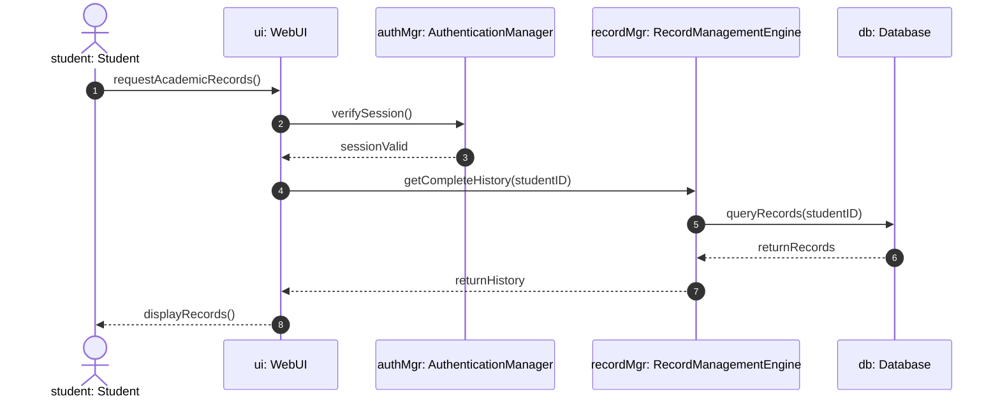
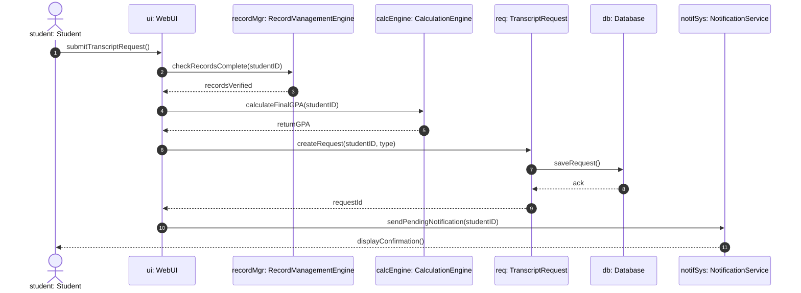
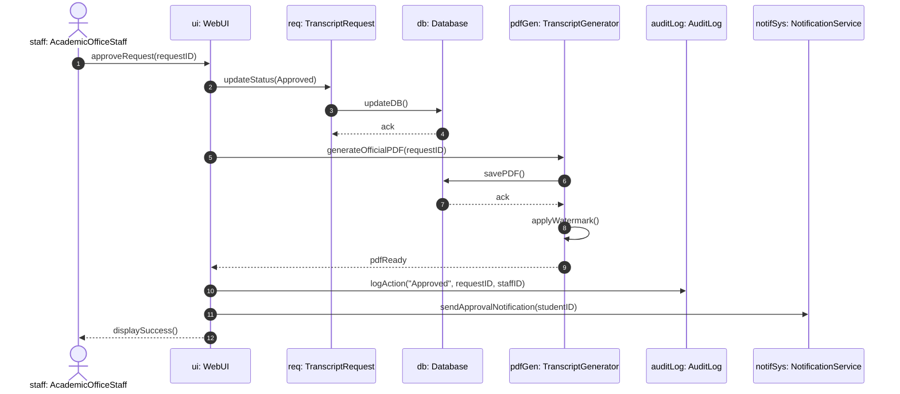
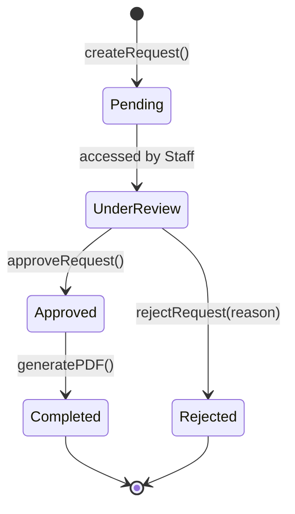
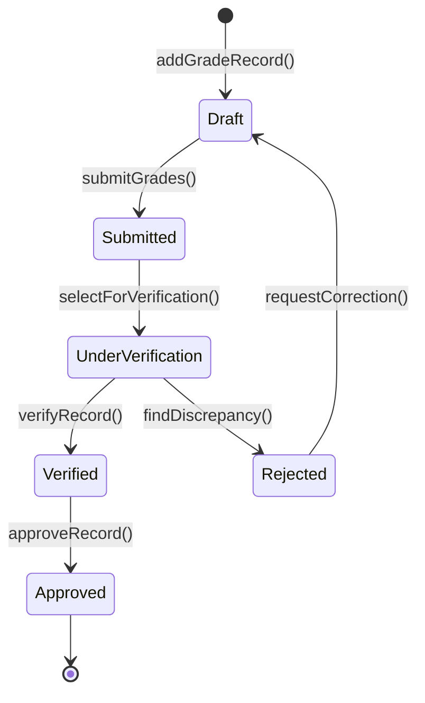
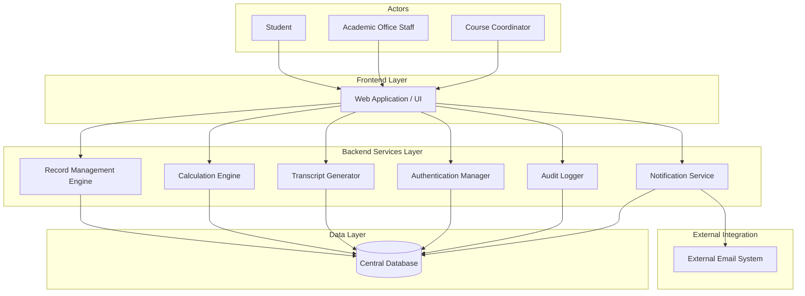

# The LNM Institute of Information Technology, Jaipur
## Software Development Laboratory
**Course Code:** CS314  
**Lab Assignment 5:** Collaboration, State and Component Modelling  
**Project:** Transcript Generation System (TGS)  
**Team ID:** T029  
**Team Members:** Ayush Agarwal, Yash Sharma, Jatin Dangi, Daksh Kedia  
**Roll Numbers:** 24UCC171, 24UCC172, 24UCC173, 24UCC174  
**Development Model:** Agile - Iterative and Incremental Development   

---

## 36. Collaboration Diagrams

The following collaboration models represent object interactions and message sequences across system boundaries for the three core use cases.

### 36.1 UC-007 — View Academic Records
Models how the system retrieves, validates, and renders a student's verified academic history.

---

### 36.2 UC-010 — Request Transcript
Models how the system verifies grade completeness, calculates final GPAs, generates preliminary records, and dispatches notifications.

---

### 36.3 UC-011 — Approve Transcript
Models how staff review, approve, apply official watermarks, update databases, create audit logs, and notify the student.

---

## 37. State Diagrams

### 37.1 State Diagram for TranscriptRequest
Represents the lifecycle transitions of a transcript request from initial creation to final document dispatch.

---

### 37.2 State Diagram for SemesterRecord
Represents the lifecycle stages of semester grade records from initial faculty draft to official approval.

---

## 38. Component Diagram

The multi-tier system architecture is organized across the Presentation (Frontend), Business Logic (Backend Services), and Persistence (Data) layers.

---

## 39. Individual Contribution

* **Daksh Kedia (24UCC174) – Project / Requirement Lead:** Ensured structural compliance by tracing all identified classes and associations directly back to the Functional Requirements and Business Rules established in the initial requirements specification. For Assignment 5, ensured end-to-end requirement traceability across the collaboration diagrams for UC-007, UC-010, and UC-011.
* **Yash Sharma (24UCC172) – Design / Architecture Lead:** Designed and modeled the comprehensive UML Class Diagram, establishing the structural architecture, multiplicities, and specific generalization and composition relationships. For Assignment 5, designed the system Component Diagram across the Frontend, Backend Services, and Data Layer modules.
* **Ayush Agarwal (24UCC171) – Development Lead:** Identified the core system classes along with their essential attributes and operations, and designed the UML Object Diagram representing the transcript approval snapshot. For Assignment 5, modeled the UML State Diagrams for the complete lifecycles of TranscriptRequest and SemesterRecord.
* **Jatin Dangi (24UCC173) – Testing & Documentation Lead:** Documented the relationship justifications, verified architectural consistency between Assignment 3 activity diagrams and the new class structures, and managed the GitHub Markdown compilation. For Assignment 5, verified consistency between class models and collaboration interactions, and maintained report compilation alongside the AI policy declarations.

---

## AI Usage Policy — Student Declaration

AI tools may be used as supporting tools for this assignment. The team is responsible for the correctness, consistency, and understanding of all submitted requirements, models, and code.
* We have disclosed the use of AI tools, if any.
* AI-generated suggestions have been reviewed, verified, and adapted by the team.
* We understand and can explain the submitted collaboration diagrams, state models, and component architecture.
* We have verified that the UML models are consistent with our project's scope and baseline requirements.
* The final submission represents our team's understanding and engineering decisions.

| Item | Details |
|---|---|
| **AI Tool(s) Used** | Gemini (Google) |
| **Purpose of AI Use** | Supporting the team in structuring collaboration message flows, formatting state transitions, validating component layer responsibilities, and ensuring comprehensive coverage of transcript generation workflows. All AI suggestions have been reviewed, verified, and adapted by the team. |
| **Team ID** | T029 |
| **Team Member Names** | Ayush Agarwal (24UCC171), Yash Sharma (24UCC172), Jatin Dangi (24UCC173), Daksh Kedia (24UCC174) |
