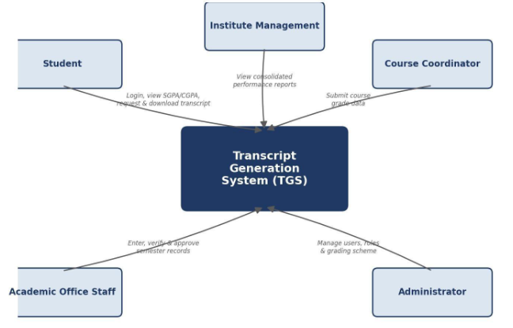

# Lab Assignment 02 — Software Requirements Specification (SRS v1.0)

**Course:** CS314 — Software Development Laboratory  
**Institute:** The LNM Institute of Information Technology, Jaipur  
**Project:** Transcript Generation System (TGS)  
**Team ID:** T029 [Ayush Agarwal (24UCC171), Yash Sharma (24UCC172), Jatin Dangi (24UCC173), Daksh Kedia (24UCC174)]  

---

## 11. User Classes

### 11.1 Student
Students are enrolled individuals who need academic transcripts for various purposes such as higher education, placements, and scholarships. They shall be able to:
- Authenticate using institutional credentials
- View their own academic records
- View semester-wise grades and credits
- View calculated SGPA and CGPA
- Request transcript generation
- Download generated transcripts
- View transcript generation history
- Receive notifications about transcript status

### 11.2 Course Coordinator / Faculty
Course coordinators and faculty members are responsible for submitting and confirming grade data for courses they teach. They shall be able to:
- Log in with authorized credentials
- Submit course grades for students
- Confirm submitted grade data
- Update grades within permitted timelines
- View submitted grade records
- Receive confirmation of grade submission

### 11.3 Academic / Examination Office Staff
Academic/Examination office staff manage the verification and approval of academic records and transcripts. They shall be able to:
- Log in with authorized credentials
- Upload semester-wise grade records
- Verify student academic records
- Approve transcript generation requests
- Search and filter student records
- Correct errors in academic records subject to proper authorization
- View pending verification/approval requests
- Generate academic reports
- Access audit trail of record modifications

### 11.4 Administrator
The system administrator manages users, system configuration, and overall system operations. The administrator shall:
- Manage user accounts across all roles
- Assign and modify user roles
- Configure grading scheme and credit structure
- Manage system-level settings
- Monitor system activity and logs
- Access comprehensive administrative reports
- Maintain audit trail records
- Handle system backup and security

### 11.5 Institute Management
Management users require aggregated academic performance data for institutional oversight. They shall have access to:
- Consolidated academic performance reports
- Batch-wise and department-wise analytics
- SGPA and CGPA distribution reports
- Transcript generation statistics

---

## 12. System Context

---

## 13. Functional Requirements

### 13.1 Authentication and Account Management
- **FR-001 — User Login:** The system shall allow registered users to authenticate using valid institutional credentials.
- **FR-002 — Authentication Failure Handling:** The system shall notify users when authentication fails without revealing sensitive security information.
- **FR-003 — Logout:** The system shall allow authenticated users to terminate their session securely.
- **FR-004 — Role Assignment:** The system shall allow authorized administrators to assign roles to users.
- **FR-005 — Role-Based Access Control:** The system shall restrict system functions according to the user's assigned role.

### 13.2 Grade Record Management
- **FR-006 — Upload Grade Records:** The system shall allow authorized academic office staff to upload semester-wise grade records for students.
- **FR-007 — Submit Course Grades:** The system shall allow authorized course coordinators to submit grades for students enrolled in their courses.
- **FR-008 — Grade Data Entry:** The system shall allow entry of grade information including: Student ID, Course code, Course name, Credits, Grade obtained, Semester, and Academic year.
- **FR-009 — Edit Grade Records:** The system shall allow authorized users to edit grade records subject to defined permissions and approval workflows.
- **FR-010 — Grade Record Verification:** The system shall allow authorized academic office staff to verify submitted grade records before finalization.
- **FR-011 — Grade Record Approval:** The system shall require approval from authorized personnel before grade records become official.

### 13.3 Credit Calculation
- **FR-012 — Calculate Credits Earned:** The system shall automatically calculate credits earned for each course based on the grade obtained and the course credit weight.
- **FR-013 — Grade Point Mapping:** The system shall use a predefined grading scheme to map letter grades to grade points.
- **FR-014 — Credit Validation:** The system shall validate that only passing grades earn credits according to the defined grading rules.
- **FR-015 — Display Earned Credits:** The system shall display total credits earned per semester and cumulatively.

### 13.4 SGPA Calculation
- **FR-016 — Calculate SGPA:** The system shall automatically calculate the Semester Grade Point Average (SGPA) for each completed semester using the formula: SGPA = Σ(Grade Points × Credits) / Σ(Credits).
- **FR-017 — Display SGPA:** The system shall display the calculated SGPA for each semester on the student's academic record.
- **FR-018 — SGPA Recalculation:** The system shall recalculate SGPA automatically when grade records are updated or corrected.

### 13.5 CGPA Calculation
- **FR-019 — Calculate CGPA:** The system shall automatically calculate the Cumulative Grade Point Average (CGPA) across all completed semesters using the formula: CGPA = Σ(Grade Points × Credits for all semesters) / Σ(Credits for all semesters).
- **FR-020 — Display CGPA:** The system shall display the current CGPA on the student's academic record.
- **FR-021 — CGPA Recalculation:** The system shall recalculate CGPA automatically when any semester grade records are updated.

### 13.6 Transcript Generation
- **FR-022 — Request Transcript:** The system shall allow authenticated students to request generation of their academic transcript.
- **FR-023 — Transcript Content:** The system shall include in the generated transcript: Student personal information, Semester-wise course details (code, name, credits, grade), Semester-wise SGPA, Cumulative CGPA, Total credits earned, Transcript generation date, and Verification status.
- **FR-024 — Transcript Format:** The system shall generate transcripts in a standardized, professionally formatted PDF document.
- **FR-025 — Transcript Approval Workflow:** The system shall require academic office approval before a transcript is marked as official.
- **FR-026 — Download Transcript:** The system shall allow students to download their approved transcript as a PDF file.
- **FR-027 — Transcript Watermark:** The system shall apply appropriate watermarks indicating the transcript's official status.

### 13.7 Record Viewing and Access
- **FR-028 — View Own Academic Records:** The system shall allow students to view their complete academic records including all semesters.
- **FR-029 — View Transcript History:** The system shall allow students to view their transcript generation history including request dates and status.
- **FR-030 — Search Student Records:** The system shall allow authorized academic office staff to search student records by student ID, name, or batch.
- **FR-031 — Filter Student Records:** The system shall allow authorized staff to filter student records by relevant criteria such as program, semester, or year.

### 13.8 Notification Management
- **FR-032 — Grade Submission Notification:** The system shall notify students when new grades are submitted or updated.
- **FR-033 — Transcript Status Notification:** The system shall notify students about the status of their transcript request (pending, approved, ready for download).
- **FR-034 — Approval Notification:** The system shall notify academic office staff when transcript approval is required.
- **FR-035 — View Notifications:** The system shall allow users to view their notifications.

### 13.9 Reporting and Dashboard
- **FR-036 — Academic Office Dashboard:** The system shall provide academic office staff with a dashboard showing pending approvals, recent transcript requests, and key statistics.
- **FR-037 — Student Performance Report:** The system shall generate reports showing student academic performance including SGPA and CGPA trends.
- **FR-038 — Batch Performance Report:** The system shall generate batch-wise performance reports for authorized users.
- **FR-039 — Transcript Generation Report:** The system shall generate reports on transcript generation activity and statistics.
- **FR-040 — Export Reports:** The system shall allow authorized users to export reports in standard formats (PDF, CSV).

### 13.10 Audit Trail
- **FR-041 — Record Modifications Log:** The system shall maintain an audit trail of all grade record entries, edits, and approvals.
- **FR-042 — User Action Log:** The system shall log significant user actions including who made changes, what was changed, and when.
- **FR-043 — View Audit Trail:** The system shall allow authorized administrators to view the audit trail for accountability and troubleshooting.

---

## 14. Business Rules

| ID | Business Rule |
| :--- | :--- |
| **BR-001** | Only authorized academic office staff can upload or modify grade records. |
| **BR-002** | Grade records must be verified before being used in transcript generation. |
| **BR-003** | Credits are earned only for grades above the minimum passing grade as defined in the grading scheme. |
| **BR-004** | SGPA is calculated only for semesters with complete and verified grade records. |
| **BR-005** | CGPA includes all completed semesters with verified grades. |
| **BR-006** | A transcript can be marked official only after approval by authorized academic office staff. |
| **BR-007** | Students can only view and download their own academic records and transcripts. |
| **BR-008** | The grading scheme and credit structure must be configured before grade entry. |
| **BR-009** | Grade modifications after approval require additional authorization and must be audited. |
| **BR-010** | Only students with at least one completed semester can request a transcript. |
| **BR-011** | Course coordinators can only submit grades for courses assigned to them. |
| **BR-012** | All transcript generation requests must be logged with timestamp and requester information. |

---

## 15. Non-Functional Requirements

### 15.1 Performance
- **NFR-001:** The system should provide acceptable response times for grade record retrieval and SGPA/CGPA calculation under normal load.
- **NFR-002:** Transcript generation should complete within 10 seconds for a typical 8-semester academic record.
- **NFR-003:** The system should support concurrent access by at least 100 users during peak periods such as semester end.

### 15.2 Security
- **NFR-004:** All system functionality shall require user authentication.
- **NFR-005:** Access to academic records and transcripts shall be controlled strictly by user roles.
- **NFR-006:** Student academic data shall not be accessible to unauthorized users.
- **NFR-007:** All grade record modifications shall be logged with user identity, timestamp, and modification details.
- **NFR-008:** Passwords shall be stored using industry-standard hashing algorithms.
- **NFR-009:** Transcript PDFs shall include security features to prevent unauthorized modification.

### 15.3 Usability
- **NFR-010:** The interface shall provide clear navigation for accessing academic records and requesting transcripts.
- **NFR-011:** Error messages shall be informative and guide users toward resolution.
- **NFR-012:** Common tasks such as viewing grades and downloading transcripts should require minimal steps.
- **NFR-013:** The system should provide helpful guidance for first-time users.

### 15.4 Reliability
- **NFR-014:** Grade records and calculated SGPA/CGPA values shall be maintained reliably without loss.
- **NFR-015:** Calculation of credits, SGPA, and CGPA must be accurate according to the defined formulae.
- **NFR-016:** The system shall handle errors gracefully and inform users appropriately.

### 15.5 Availability
- **NFR-017:** The system should be available 99% of the time during academic office hours, excluding scheduled maintenance.

### 15.6 Maintainability
- **NFR-018:** The software shall follow a modular architecture separating grade management, calculation engine, and transcript generation.
- **NFR-019:** Source code shall be maintained in a version-controlled Git repository.
- **NFR-020:** Documentation shall be maintained alongside system changes.

### 15.7 Scalability
- **NFR-021:** The system architecture should support growth to accommodate thousands of student records across multiple academic years.
- **NFR-022:** The database design should allow efficient querying as data volume increases.

### 15.8 Compatibility
- **NFR-023:** The system should operate correctly on commonly used modern web browsers (Chrome, Firefox, Safari, Edge).
- **NFR-024:** Generated transcript PDFs should be viewable on all standard PDF readers.

### 15.9 Privacy
- **NFR-025:** Student academic information shall be accessible only to the student themselves and authorized staff.
- **NFR-026:** The system shall comply with institutional data protection policies.

### 15.10 Auditability
- **NFR-027:** All grade record entries, modifications, and approvals should be recorded in an audit trail.
- **NFR-028:** Transcript generation requests and approvals should be logged for future reference.

---

## 16. Data Requirements

- **User:** User ID, Name, Email, Role (Student, Faculty, Academic Office, Administrator), Department/Program, Account status, Last login.
- **Student:** Student ID, Name, Email, Program/Branch, Batch/Year of admission, Current semester, Account status.
- **Course:** Course ID/Code, Course name, Credits, Department, Course type (Core, Elective, etc.).
- **Grade Record:** Record ID, Student ID, Course code, Semester, Academic year, Grade obtained, Credits assigned, Credits earned, Submission date, Verification status, Approved by, Approval date.
- **Grading Scheme:** Grade (A+, A, B+, B, C, D, F, etc.), Grade points, Minimum percentage/marks, Pass/Fail status.
- **Semester Record:** Record ID, Student ID, Semester number, Academic year, Total credits registered, Total credits earned, SGPA, Calculation date, Status.
- **Transcript:** Transcript ID, Student ID, Generation date, Requested by, Status (Pending, Approved, Generated), Approved by, Approval date, File path/URL, Transcript type (Official, Unofficial).
- **Notification:** Notification ID, Recipient (User ID), Notification type, Message content, Related entity (Grade Record, Transcript), Timestamp, Read status.
- **Audit Log:** Log ID, User ID, Action performed, Entity affected (Grade Record, Transcript), Entity ID, Changes made, Timestamp, IP address.

---

## 17. Semester Record Lifecycle

A semester record passes through the following states:
- **Draft:** Created by academic office staff or a course coordinator, not yet submitted.
- **Submitted:** Sent forward for verification.
- **Under Verification:** Reviewed by academic office staff for correctness and completeness.
- **Verified:** Confirmed correct, awaiting final approval.
- **Approved:** Marked official; included in SGPA/CGPA and transcript calculation.
- **Rejected:** Returned with a reason; may be revised and resubmitted.

---

## 18. Major Use Cases

| ID | Use Case | Primary Actor |
| :--- | :--- | :--- |
| **UC-001** | Login | All users |
| **UC-002** | Manage Users | Administrator |
| **UC-003** | Configure Grading Scheme | Administrator |
| **UC-004** | Upload Grade Records | Academic Office Staff |
| **UC-005** | Submit Course Grades | Course Coordinator |
| **UC-006** | Verify Grade Records | Academic Office Staff |
| **UC-007** | View Academic Records | Student |
| **UC-008** | Calculate SGPA | System |
| **UC-009** | Calculate CGPA | System |
| **UC-010** | Request Transcript | Student |
| **UC-011** | Approve Transcript | Academic Office Staff |
| **UC-012** | Generate Transcript PDF | System |
| **UC-013** | Download Transcript | Student |
| **UC-014** | Search Student Records | Academic Office Staff |
| **UC-015** | View Audit Trail | Administrator |
| **UC-016** | Generate Reports | Academic Office Staff / Management |
| **UC-017** | View Notifications | All authenticated users |

---

## 19. Detailed Use Case Examples

### UC-007 — View Academic Records
- **Primary Actor:** Student
- **Preconditions:** Student is authenticated; Student has at least one semester with grade records.
- **Main Flow:**
  1. Student navigates to "My Academic Records" section.
  2. System retrieves student's complete academic history.
  3. System displays semester-wise grade records.
  4. System displays courses with course code, name, credits, and grade.
  5. System displays calculated SGPA for each semester.
  6. System displays overall CGPA.
  7. System displays total credits earned.
  8. Student can view detailed information for any semester.
- **Alternative Flows:**
  - If no grade records exist → System displays message that no records are available.
  - If SGPA/CGPA calculation is pending → System shows status as "Under Processing".
- **Postcondition:** Student has viewed their complete academic records.

### UC-010 — Request Transcript
- **Primary Actor:** Student
- **Preconditions:** Student is authenticated; Student has at least one completed semester with verified grades.
- **Main Flow:**
  1. Student navigates to "Request Transcript" section.
  2. System displays transcript request form.
  3. Student selects transcript type (Official/Unofficial).
  4. Student optionally provides purpose or remarks.
  5. Student submits transcript request.
  6. System validates that grade records are complete and verified.
  7. System creates transcript request record.
  8. System calculates final SGPA and CGPA.
  9. System generates preliminary transcript.
  10. System sends request to academic office for approval.
  11. System displays confirmation to student with request ID.
  12. System sends notification to academic office staff.
- **Alternative Flows:**
  - If grade records are incomplete → System notifies student that transcript cannot be generated.
  - If student has pending corrections → System notifies student to resolve issues first.
  - If system error occurs during generation → System logs error and notifies administrators.
- **Postcondition:** Transcript request is created and pending approval.

### UC-011 — Approve Transcript
- **Primary Actor:** Academic Office Staff
- **Preconditions:** Staff member is authenticated with Academic Office role; Transcript request exists and is pending approval; All grade records are verified.
- **Main Flow:**
  1. Staff member accesses pending transcript approval queue.
  2. System displays list of pending transcript requests.
  3. Staff member selects a transcript request to review.
  4. System displays student details and generated transcript preview.
  5. Staff member reviews transcript for accuracy and completeness.
  6. Staff member verifies student eligibility.
  7. Staff member approves the transcript request.
  8. System updates transcript status to "Approved".
  9. System applies official watermark to transcript PDF.
  10. System records approval details (approver ID, timestamp).
  11. System sends notification to student that transcript is ready.
  12. System logs the approval action in audit trail.
- **Alternative Flows:**
  - If discrepancies are found → Staff member rejects request with comments.
  - If additional verification needed → Staff member marks request for manual review.
  - If student is not eligible → Staff member rejects request with reason.
- **Postcondition:** Transcript is officially approved and ready for download by the student.

---

## 20. User Stories

- **US-001:** As a student, I want to log in using my institutional credentials so that I can securely access my academic records.
- **US-002:** As a student, I want to view my semester-wise grades and credits so that I can track my academic progress.
- **US-003:** As a student, I want to see my calculated SGPA and CGPA so that I know my overall academic performance.
- **US-004:** As a student, I want to request an academic transcript so that I can apply for higher education or job opportunities.
- **US-005:** As a student, I want to download my approved transcript as a PDF so that I can submit it to external organizations.
- **US-006:** As a course coordinator, I want to submit grades for my courses so that student records are updated.
- **US-007:** As academic office staff, I want to upload semester-wise grade records so that transcripts can be generated.
- **US-008:** As academic office staff, I want to verify grade records before finalization so that only accurate data is used.
- **US-009:** As academic office staff, I want to approve transcript requests so that only validated transcripts are issued.
- **US-010:** As academic office staff, I want to search and filter student records so that I can quickly find specific information.
- **US-011:** As an administrator, I want to configure the grading scheme so that credit and GPA calculations are accurate.
- **US-012:** As an administrator, I want to manage user roles so that access to the system is properly controlled.
- **US-013:** As an administrator, I want to view the audit trail so that I can track system changes and ensure accountability.
- **US-014:** As institute management, I want to generate academic performance reports so that I can monitor institutional outcomes.
- **US-015:** As a student, I want to receive notifications when my transcript is ready so that I can download it promptly.

---

## 21. Acceptance Criteria Examples

### US-003 — View Calculated SGPA and CGPA
| ID | Acceptance Criterion |
| :--- | :--- |
| **AC-01** | Student must be authenticated |
| **AC-02** | At least one semester must have verified grades |
| **AC-03** | SGPA must be displayed for each completed semester |
| **AC-04** | SGPA must be calculated using the formula: SGPA = Σ(Grade Points × Credits) / Σ(Credits) |
| **AC-05** | CGPA must be displayed showing cumulative performance |
| **AC-06** | CGPA must include all completed semesters |
| **AC-07** | Calculations must be accurate to two decimal places |
| **AC-08** | System must show total credits earned |

### US-004 — Request Academic Transcript
| ID | Acceptance Criterion |
| :--- | :--- |
| **AC-01** | Student must be authenticated |
| **AC-02** | Student must have at least one completed semester |
| **AC-03** | All grade records must be verified |
| **AC-04** | System must validate completeness of records before accepting request |
| **AC-05** | Request must be logged with timestamp and student ID |
| **AC-06** | Student must receive confirmation with request ID |
| **AC-07** | Academic office must be notified of pending approval |
| **AC-08** | Transcript must include all required information (grades, SGPA, CGPA, credits) |

### US-009 — Approve Transcript Requests
| ID | Acceptance Criterion |
| :--- | :--- |
| **AC-01** | User must be authenticated as academic office staff |
| **AC-02** | Pending transcript requests must be displayed in a queue |
| **AC-03** | Staff must be able to preview the generated transcript |
| **AC-04** | Staff must be able to approve or reject the request |
| **AC-05** | Rejection must require a reason or comment |
| **AC-06** | Approved transcripts must be marked as "Official" |
| **AC-07** | Student must be notified upon approval |
| **AC-08** | Approval action must be logged in audit trail with staff ID and timestamp |

---

## 22. Requirements Prioritization

### Must Have
- User authentication and role-based access
- Grade record upload and entry
- Credit calculation based on grades
- SGPA calculation per semester
- CGPA calculation across semesters
- Transcript generation (PDF)
- Transcript approval workflow
- View academic records for students
- Basic notifications

### Should Have
- Grade record verification workflow
- Search and filter student records
- Transcript history and status tracking
- Academic office dashboard
- Audit trail for record modifications
- Grade submission by course coordinators
- Basic academic performance reports

### Could Have
- Advanced analytics and performance trends
- Batch-wise comparative reports
- Email notifications for all events
- Transcript request tracking with detailed status
- Automated reminders for pending approvals
- Mobile-responsive design
- Export functionality for reports

### Won't Have in Initial Release
- Online fee payment for transcript requests
- Integration with external degree verification agencies
- Backlog/re-evaluation management workflows
- Complete ERP integration
- AI-based performance prediction
- Mobile native application
- Blockchain-based transcript verification
- Multiple curriculum structure support

---

## 23. Requirements Traceability Matrix (RTM)

| Requirement | User Story | Use Case | Test |
| :--- | :--- | :--- | :--- |
| **FR-012** | US-003 | UC-008 | TBD |
| **FR-016** | US-003 | UC-008 | TBD |
| **FR-019** | US-003 | UC-009 | TBD |
| **FR-022** | US-004 | UC-010 | TBD |
| **FR-025** | US-009 | UC-011 | TBD |
| **FR-026** | US-005 | UC-013 | TBD |
| **FR-028** | US-002 | UC-007 | TBD |
| **FR-030** | US-010 | UC-014 | TBD |
| **FR-036** | US-010 | UC-016 | TBD |
| **FR-041** | US-013 | UC-015 | TBD |

---

## 24. Requirements Validation

- **Correctness:** Does each requirement represent a genuine need for transcript generation and academic record management?
- **Unambiguity:** Can each requirement be interpreted in only one way without confusion?
- **Completeness:** Does each requirement contain sufficient detail for implementation and testing?
- **Consistency:** Are requirements free from conflicts with each other and with business rules?
- **Verifiability:** Can we test whether each requirement has been satisfied through specific test cases?
- **Feasibility:** Can each requirement be realistically implemented within the project constraints?
- **Traceability:** Can we identify the origin of each requirement and follow it through to implementation?
- **Prioritization:** Do we clearly understand which requirements are critical versus desirable?
- **Modifiability:** Can requirements be updated without disrupting the entire specification?

---

## 25. Example of Requirement Quality

- **Poor:** *"The system should calculate grades quickly and accurately."* — This is vague, not measurable, and lacks specific detail about what calculations are needed.
- **Better:** *"The system shall automatically calculate the Semester Grade Point Average (SGPA) for each completed semester using the formula: SGPA = Σ(Grade Points × Credits) / Σ(Credits), and display the result accurate to two decimal places."* — This is specific, testable, and provides clear calculation logic.

---

## 26. Requirement Change Management

Because TGS follows Agile development, requirements can change during the project. For example:
- **Change Request:** Add email notification when a transcript is approved and ready for download.
- **Workflow:** `Change Request → Prioritization → Impact Analysis → Requirement Update → Backlog Update → Sprint Planning → Design Change → Implementation → Testing → Release`

---

## 27. Future Requirements

1. Bulk upload of grade records via file (CSV/Excel).
2. Email/SMS notifications for status changes.
3. Digital signature or QR-based verification on the transcript PDF.
4. Integration with external universities or degree-verification agencies.
5. Mobile application.
6. Advanced analytics for institute management.
7. Support for multiple academic programmes/curricula.

---

## 28. SRS Baseline and Versioning

- **Initial baseline:** SRS v1.0
- **Version Control Information:** This version establishes the core requirements for the Transcript Generation System, covering grade record management, automated SGPA and CGPA calculation, transcript generation with approval workflow, and basic reporting capabilities for academic office staff.

---

## AI USAGE POLICY — STUDENT DECLARATION

AI tools may be used as supporting tools for this assignment, but the submitted work must represent the team's own understanding and contribution.

| Item | Details |
| :--- | :--- |
| **AI Tool Used** | Gemini (Google) |
| **Purpose of AI Use** | Supporting the team in structuring the requirements specification document, organizing functional and non-functional requirements based on our project scope, reviewing consistency between calculation logic and business rules, improving clarity and testability of requirements statements, and ensuring comprehensive coverage of transcript generation workflows. All AI suggestions have been reviewed, verified, and adapted by the team. |
| **Team ID** | T029 |
| **Team Member Names** | Ayush Agarwal (24UCC171), Yash Sharma (24UCC172), Jatin Dangi (24UCC173), Daksh Kedia (24UCC174) |
| **Team Declaration** | We confirm that the information provided above is accurate and that we accept responsibility for the submitted work. |
